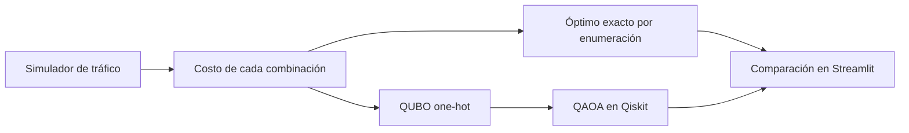

# 🚦 Simaphuru

**Repartimos el tiempo de verde en semáforos conectados usando QAOA en Qiskit, y lo comparamos contra la solución exacta.**

Qiskit Fall Fest 2026 · Categoría **Algoritmos y aplicaciones** · Reto *Optimización de rutas y conexiones mediante algoritmos cuánticos* · Equipo **patolovers**

## Mejora preparada para la final

La interfaz permite comparar **one-hot** con una **codificación binaria de un qubit por cruce**, usando
el mismo simulador, programas y costo por pares. En el caso predeterminado de dos cruces, p=3 y semilla 7,
P(óptimo) pasa de 28,36% a **99,90%**, con 2 qubits en lugar de 4. El barrido incluye tres escenarios
sintéticos, dos tamaños y tres semillas: 36 corridas. Es una mejora de formulación frente a nuestra
versión one-hot; no una ventaja cuántica frente al óptimo clásico.

La interfaz abre en binaria; one-hot sigue disponible y la CLI la mantiene por defecto para
reproducir las cifras históricas siguientes. Seleccionar **Representación de programas → Dos qubits
por cruce · one-hot** para ver la versión inicial.
La aproximación física de cinco cruces no se elimina al reducir qubits.

Ver [assessment y plan para la final](docs/FINAL_ASSESSMENT.md),
[validación comparativa](docs/FINAL_VALIDATION.md) y [contrato 0.3](docs/CONTRACTS.md).

```sh
python -m quantum.run_qaoa --n 2 --encoding binary --out artifacts/binary_two.json
python -m quantum.benchmark_encodings --out artifacts/final_encodings.json
```

### Híbrido con verificación física

Activar **Comparar búsqueda híbrida** y abrir la pestaña **Híbrido verificado**. Parte del programa
clásico por pares, muestrea propuestas QAOA y vuelve a simular los candidatos. Conserva el inicial si
ninguno mejora su costo. Se compara con muestreo uniforme y búsqueda local bajo los mismos límites de
propuestas y evaluaciones físicas; se informa también el trabajo efectivo y el entrenamiento adicional.
Esta variante no implementa warm-start del estado cuántico.

```sh
python -m quantum.run_qaoa --n 5 --encoding binary --hybrid --out artifacts/hybrid_five.json
python -m quantum.benchmark_hybrid --out artifacts/final_hybrid.json
```

Ver [protocolo y resultados del híbrido](docs/HYBRID_VALIDATION.md). La mejora verificada no implica que
el componente cuántico supere a las búsquedas clásicas: se publica la comparación completa.

### Reproductor sincronizado y tamaños intermedios

Animación, tarjetas y reloj comparten un único instante. Mover el deslizador pausa el reproductor;
las tarjetas muestran también espera externa, tránsito y el evento real de bloqueo registrado por el motor.
El selector permite **2, 3, 4 o 5 cruces**, sin cambiar el catálogo ni las ecuaciones de tráfico.
Ver [pruebas de reproducción y evaluación de tres/cuatro cruces](docs/PLAYBACK_AND_CORRIDORS.md).

---

## El problema

En una avenida con varios semáforos seguidos, cada cruce afecta al siguiente: los autos que salen de uno entran al tramo que lleva al otro. Ese tramo tiene espacio limitado. Si se llena, el cruce anterior **queda bloqueado aunque tenga luz verde**, porque los autos no tienen a dónde avanzar. A esto se le llama *spillback*.

Por eso no basta con ajustar cada semáforo por separado: un plan que ayuda a un cruce puede atascar al de atrás. Hay que decidir **en conjunto**, y el número de combinaciones crece como 2ᴺ con N cruces.

El tiempo de verde es un **recurso escaso** (el verde que gana una calle lo pierde la otra) que hay que repartir en una **red de cruces conectados**. Es justo el tipo de problema que plantea el reto: seleccionar la mejor combinación minimizando un costo y respetando restricciones.

## Cómo lo resolvimos



**1. Simulamos el corredor.** Un motor de tráfico segundo a segundo con dos cruces (A y B), cada uno con una cola norte-sur y otra este-oeste. Los autos que salen de A tardan 20 s en llegar a B, y el tramo entre ambos guarda como máximo **12 autos**. Si se llena, A no puede despachar: el spillback está modelado. Ningún vehículo se pierde ni se duplica (error de conservación 0).

**2. Definimos la decisión y el costo.** Cada cruce elige uno de dos planes en un ciclo de 68 s: **plan 0** (verde 30/30 s) o **plan 1** (prioridad norte-sur, 40/20 s). El costo combina la demora media, la cola máxima y los autos que siguen esperando al final.

**3. Calculamos la respuesta exacta.** Simulamos todas las combinaciones y tomamos la de menor costo. Esa es la referencia contra la que medimos todo lo demás.

**4. Lo convertimos en un QUBO.** Usamos un qubit por plan (4 qubits para 2 cruces) y una penalización que obliga a elegir exactamente un plan por cruce. Verificamos los 16 estados posibles: el QUBO reproduce exactamente los costos del simulador y todos sus mínimos son planes válidos.

**5. Lo resolvimos con QAOA.** Construimos el circuito en Qiskit (superposición, capa de costo, capa de mezcla) con 3 capas, y un optimizador clásico ajusta los ángulos. Usamos `Statevector`, así que las probabilidades son exactas y todo corre en local, sin cuenta de IBM.

**6. Lo mostramos.** Una app en Streamlit compara el resultado de QAOA con el óptimo exacto, explica el proceso paso a paso y **anima los carros** en el corredor, marcando cuándo un cruce queda bloqueado.

## Resultados (2 cruces)

Los resultados actuales (codificación binaria e híbrido verificado) están arriba, en
[Mejora preparada para la final](#mejora-preparada-para-la-final).

### Versión inicial (one-hot, 4 qubits)

| Plan (A, B) | Costo | Segundos bloqueado |
|---|---|---|
| 00 · programa base | 24,09 | 43 s |
| 01 | 26,89 | 234 s |
| **10 · óptimo exacto** | **17,91** | **0 s** |
| 11 | 20,08 | 38 s |

- **El mejor plan elimina el bloqueo** (43 s → 0 s) y baja el costo de 24,09 a 17,91.
- **QAOA elige el mismo plan que el óptimo exacto:** `10` es su plan válido más probable.
- Devuelve el óptimo con probabilidad **28,4 %**. Elegir al azar entre los 16 estados da 6,3 %, y entre los 4 planes válidos, 25 %.
- El **97,1 %** de lo que mide son planes válidos (un plan por cruce).

También probamos **5 cruces** (32 combinaciones). Ahí el QUBO usa una aproximación por pares de cruces vecinos y elige `11001` (costo 52,93) en vez del óptimo `11100` (48,63). Lo publicamos como resultado: muestra dónde hay que mejorar la formulación.

Configuración: QAOA p=3, 3 reinicios de Nelder-Mead, semilla 7. Fuentes: `artifacts/team_two.json`, `artifacts/team_five.json` y [docs/VALIDATION.md](docs/VALIDATION.md).

## Lo que no afirmamos

- **No es una avenida real calibrada.** Los parámetros son ilustrativos; el mecanismo de spillback sí es real.
- **No hay ventaja cuántica.** Con 4 o 32 combinaciones, la enumeración clásica da el óptimo exacto en milisegundos. Nuestro aporte es la formulación verificada y la comparación honesta contra la referencia exacta.

## Cómo correrlo

Requiere Python 3.11–3.13.

```sh
git clone https://github.com/waffles-gif/Simaphuru_patolovers.git
cd Simaphuru_patolovers
python3 -m venv .venv
source .venv/bin/activate            # Windows: .venv\Scripts\Activate.ps1
python -m pip install -r requirements.txt

python -m streamlit run app.py       # abre la app y pulsa "Ejecutar experimento"
python -m pytest                     # pruebas automáticas
```

Desde la línea de comandos, con el mismo motor:

```sh
python -m quantum.run_qaoa --input data/model_output.json --out artifacts/team_two.json   # 2 cruces
python -m quantum.run_qaoa --n 5 --out artifacts/team_five.json                          # 5 cruces
```

## Equipo

| Rol | Integrante |
|---|---|
| Evidencia y modelo físico | Daniel |
| Formulación QUBO y Qiskit | Rafael |
| Motor de tráfico | Valentino |
| Interfaz y entrega | Tamara |

Más detalles técnicos en [docs/](docs/): modelo, contratos, validación, fuentes y guion de la demo.
