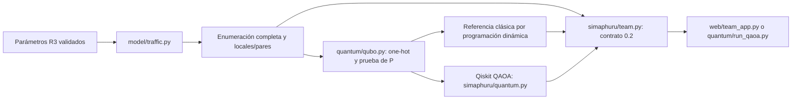
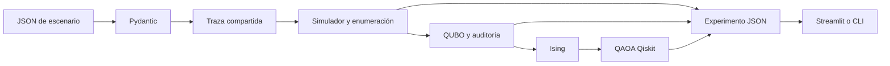

# Arquitectura y stack

Todo el MVP utiliza Python. Streamlit llama al mismo flujo que la CLI; no hay API HTTP propia, base de datos ni frontend separado.

## Flujo predeterminado adaptado a GitHub

`model/traffic.py` conserva las ecuaciones del equipo. `simaphuru/team.py` valida parámetros, obtiene costos e historiales del mismo motor y añade diagnósticos globales. `quantum/qubo.py` transforma sus factores locales/pares en one-hot y demuestra la suficiencia de la penalización. No confundirlo con `simaphuru/qubo.py`, que ofrece el contenedor QUBO/Ising compartido y construye el sustituto por diferencias del motor experimental.

La vista experimental conserva el flujo schema 1.0 descrito abajo. En ambas opciones se comparte el entrenamiento Qiskit, pero no los estados, costos, parámetros ni resultados.

## Herramientas compartidas y flujo experimental

| Capa | Herramienta | Decisión |
|---|---|---|
| Entorno | Python + venv + requirements.lock | Instalación aislada y dependencias fijadas |
| Contrato | Pydantic | JSON con campos y unidades explícitos; rechaza campos desconocidos |
| Tráfico | Python + NumPy | Colas discretas, trazas y generador reproducible |
| Referencia | Enumeración exacta | 4 o 32 decisiones bajo el mismo escenario |
| Formulación | NumPy + Qiskit SparsePauliOp | QUBO, auditoría y conversión a Ising |
| QAOA | Qiskit Statevector + SciPy | Circuitos reales, probabilidades exactas y búsqueda de ángulos |
| Interfaz | Streamlit + pandas | Comparación, evolución y exportación |
| Calidad | pytest, Ruff, GitHub Actions | Pruebas de física, matemáticas e integración |

`experiment.py` une los módulos. No introducir lógica de tráfico o ecuaciones QUBO en `app.py`. Un cambio de escenario invalida los resultados mostrados. Los resultados guardan procedencia, versión del motor, huella del escenario/semilla y configuración QAOA.

El QAOA es un circuito parametrizado construido con puertas H, RZ, RZZ y RX; utiliza Statevector directamente en ambas vistas. Aer y Qiskit Optimization están instalados y sus interfaces se prueban, pero el entrenamiento predeterminado usa Statevector. No requiere qiskit-ibm-runtime ni credenciales. Los términos constantes solo aportan fase global y se omiten de las puertas, pero se mantienen en la evaluación de energías.

Siguiente extensión: agregar observaciones reales y validación externa; después evaluar otra arquitectura si aparecen necesidades de múltiples usuarios o persistencia. No añadir servicios para la hackathon sin una necesidad concreta.
