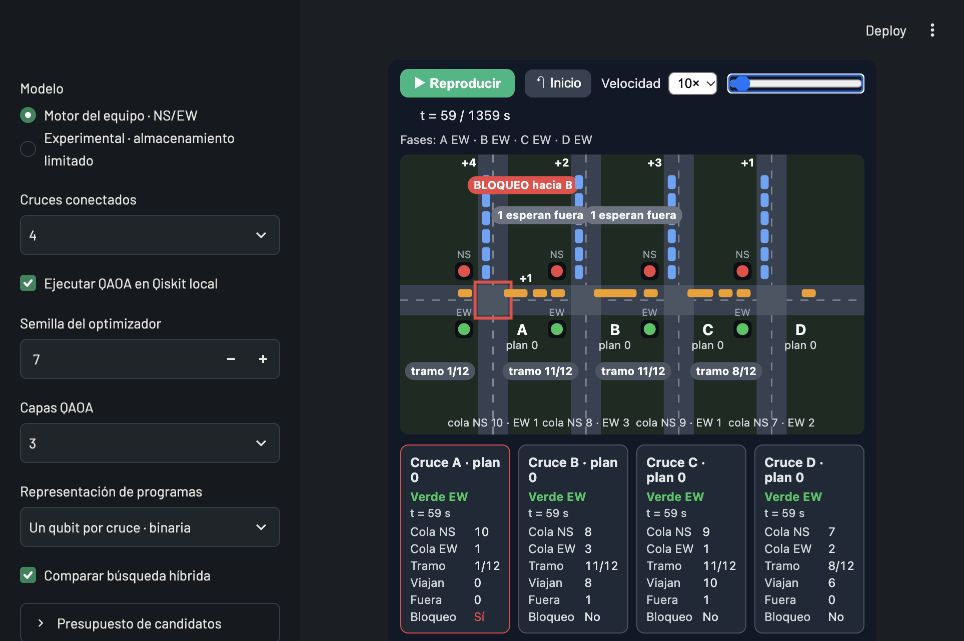

# Reproductor sincronizado y casos de tres/cuatro cruces

24/10/2026, Lima. Validación preparada en la rama `rol2/final-codificacion-binaria`; paquete 0.3.0, física `team-ns-ew-v2`. La publicación de esta entrega se identifica en el historial de Git del repositorio.

## Reloj único

El canvas, el reloj, el deslizador y las tarjetas leen exactamente el mismo registro del historial. Se elimina el deslizador estático independiente de Streamlit. Reproducir/pausar, buscar un segundo e Inicio actualizan todas esas vistas; buscar pausa la reproducción. Cambiar programa vuelve al primer paso. Los vehículos se interpolan visualmente, mientras colas y fases siguen pasos discretos de un segundo.

Las tarjetas incluyen fase, cola NS, cola EW, ocupación del enlace, vehículos en tránsito, backlog externo y bloqueo ocurrido durante el paso. El gráfico separado corresponde a todo el horizonte y los conteos finales se identifican como finales.

## Bloqueo observado, no inferido

Se añadió `history[].blocked` en la condición exacta que incrementa `blocked_s`. En la configuración base de cinco cruces, en t=59 A registra bloqueo pero el enlace de B termina con ocupación 11/12: estaba lleno al intentar despachar A y B libera espacio después. El visor anterior infería el bloqueo desde el estado final y podía omitir ese evento. Ahora el canvas y la tarjeta reproducen el evento registrado.

No se modificaron ecuaciones, tasas, capacidades ni costos. Las pruebas comparan ejecuciones con y sin historial en las 60 decisiones de N=2,3,4,5 y comprueban igualdad de métricas y suma de eventos de bloqueo con el contador. Historiales antiguos sin evento no lo inventan: muestran «sin registro».

## Evaluación de ampliar el selector

El backend y la CLI ya aceptaban N=3 y N=4; la interfaz solo ofrecía 2 y 5. Tras comprobarlos, el selector ofrece 2,3,4,5. No se añade una ecuación vial nueva ni una geometría atribuida a una avenida real.

| Cruces | Programas completos | Qubits binarios | Qubits one-hot |
|---|---:|---:|---:|
| 2 | 4 | 2 | 4 |
| 3 | 8 | 3 | 6 |
| 4 | 16 | 4 | 8 |
| 5 | 32 | 5 | 10 |

### Configuración predeterminada, p=3, entrenamiento 7, muestreo 2026

| Cruces | Codificación | Óptimo físico | Programa óptimo | Error máximo F−C | P(óptimo físico) QAOA | Costo modal QAOA | Costo híbrido |
|---|---|---:|---|---:|---:|---:|---:|
| 3 | binary | 28.925050 | 110 | 0.549092 | 79.35% | 28.925050 | 28.925050 |
| 3 | one_hot | 28.925050 | 110 | 0.549092 | 13.41% | 28.925050 | 28.925050 |
| 4 | binary | 36.244157 | 1110 | 6.977885 | 32.89% | 39.745995 | 36.244157 |
| 4 | one_hot | 36.244157 | 1110 | 6.977885 | 7.13% | 39.745995 | 36.244157 |

En tres cruces el error de costos por pares es distinto de cero aunque acierte el programa óptimo de esta configuración. En cuatro, el mejor programa por pares cuesta 3,501839 unidades más que el óptimo físico. Reducir qubits no elimina ese error. Los híbridos QAOA y clásico local recuperaron el óptimo en estos ensayos; esto no es una ventaja cuántica.

### Sensibilidad binaria

| Cruces | Escenario | Óptimo físico | Error máximo F−C | Pérdida del programa DP | Costo híbrido | Costo local clásico |
|---|---|---:|---:|---:|---:|---:|
| 3 | default | 28.925050 | 0.549092 | 0.000000 | 28.925050 | 28.925050 |
| 3 | half_demand | 6.299605 | 7.166285 | 0.000000 | 6.299605 | 6.299605 |
| 3 | limited_storage | 36.402197 | 7.805107 | 0.000000 | 36.402197 | 36.402197 |
| 4 | default | 36.244157 | 6.977885 | 3.501839 | 36.244157 | 36.244157 |
| 4 | half_demand | 12.547448 | 15.848300 | 0.142476 | 12.547448 | 12.547448 |
| 4 | limited_storage | 44.628204 | 13.141157 | 0.000000 | 44.628204 | 44.628204 |

Ocho ejecuciones nuevas: dos tamaños, tres escenarios binarios y one-hot adicional para ambos casos predeterminados. Se comprueba conservación en todas las combinaciones. Son escenarios sintéticos y una sola semilla de entrenamiento/muestreo: la evaluación sirve para integración y factibilidad, no para afirmar superioridad general. Los tiempos observados son ejecuciones locales aisladas, no una garantía de latencia.

## Pruebas y alcance

- 73 pruebas locales pasaron; Ruff pasó.
- Nuevas pruebas de registro de bloqueo, invariancia de la física, correspondencia de snapshots, compatibilidad de historiales antiguos y protección de identificadores serializados.
- Casos N=3/4 con Streamlit y QAOA binaria/híbrido; invalidación al cambiar red, selección de historial y ausencia del segundo reloj.
- Pruebas de equivalencia de codificaciones ampliadas a los cuatro tamaños. Regresión contra las referencias históricas de dos/cinco cruces: los costos, colas finales y segundos de bloqueo no cambian.
- Comprobación de sintaxis JavaScript y prueba de navegación real: pausa, reproducción, salto a t=34 y consistencia de reloj/tarjetas en cinco cruces; cuatro cruces a t=59, reinicio, final del horizonte y cambio de programa.

## Uso y recomendación para el pitch

En la demo local, abrir «Evolución del tráfico», elegir el programa y utilizar el único deslizador bajo el selector. No hay que ajustar otro reloj. Para N=3/4 basta el selector «Cruces conectados» y volver a ejecutar.

Los nuevos tamaños son útiles para exploración y preguntas; no añadiría dos demostraciones extra al pitch. Mantendría una historia de dos cruces y un corredor mayor, con las cifras ya calculadas.

Los JSON completos de esta evaluación están en `outputs/reproductor_sincronizado` de la tarea y acompañan la copia de entrega. Los benchmarks de codificación e híbrido anteriores siguen siendo históricos: sus hashes identifican el código anterior a este cambio de registro, cuyas métricas físicas se comprobaron inalteradas.

