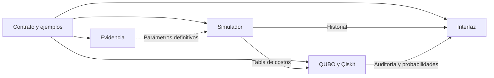

# Cuatro frentes de trabajo

Todos pueden empezar con el motor del equipo y el contrato 0.2 actual. La dependencia de datos finales es de validación, no impide comenzar. Ver la comparación y la secuencia priorizada en `docs/COMPARACION_Y_MEJORAS.md`.

| Rol | Archivos propios | Primera acción | Output para integrar |
|---|---|---|---|
| 1. Daniel · Evidencia y realismo | `docs/SOURCES.md`, parámetros de `model/traffic.py` | Clasificar supuestos y revisar significado de demora/residual | Ficha de parámetros y caso manual de receptor lleno |
| 2. Rafael · Formulación y Qiskit | `quantum/`, `simaphuru/quantum.py`, pruebas cuánticas | Revisar 4 estados válidos y 12 inválidos; explicar cota de P | Energías, prueba de factibilidad y brechas separadas |
| 3. Valentino · Simulación clásica | `model/`, pruebas físicas | Diseñar almacenamiento con transferencias y entradas exteriores contabilizadas | Motor versionado, conservación y tabla/historial actualizados |
| 4. Tamara · Interfaz y entrega | `web/`, `app.py`, `docs/DEMO.md` | Ejecutar el caso de dos cruces y comprobar hash/replay | Comparación legible, descarga, PPT y vídeo de respaldo |

## Reglas de integración

1. Una rama por cambio; PR pequeño y pruebas relevantes.
2. El rol 1 revisa el significado físico y la condición de los datos.
3. El rol 2 revisa la decisión, la aproximación y el costo original de lo seleccionado.
4. El rol 3 comprueba conservación y que el motor respete el contrato.
5. El rol 4 comprueba hashes, consistencia visual y acceso a la entrega.

Antes de la presentación priorizar dos cruces comprobados. Cinco sirven para demostrar el error del sustituto; no representan cinco cruces reales de Javier Prado. La vista experimental anterior sirve como referencia conceptual de almacenamiento, pero sus ecuaciones deben integrarse con el contrato del motor del equipo, no copiar sus cifras.

IA puede acelerar código y borradores; cada responsable debe poder explicar las ecuaciones y verificar sus resultados. No delegar la aceptación científica a que una prueba automática aparezca verde.
