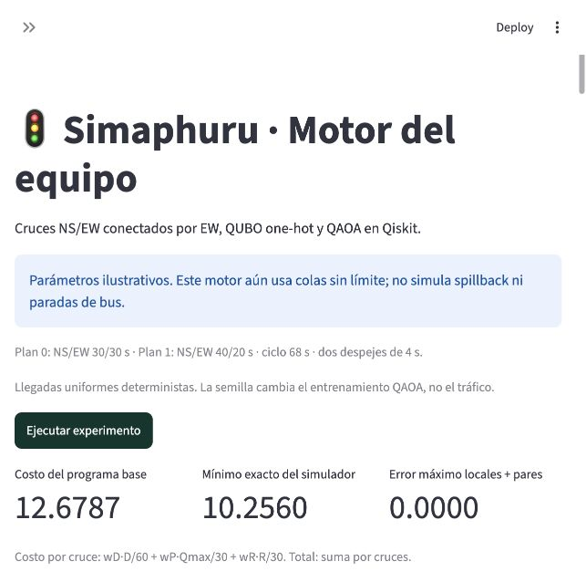

# Verificación de la entrega adaptada

Fecha: 24 de octubre de 2026. Base GitHub: `ee4eed52ba3438242aa213532c1eb5761ae5f70e`. Se volvió a consultar el remoto durante la revisión y seguía en ese commit. Este registro corresponde a la verificación local realizada antes de publicar la adaptación autorizada.

## Entorno y pruebas

- Python 3.13.2; paquete simaphuru 0.2.0.
- Qiskit 2.6.1, Aer 0.18.0, Optimization 0.7.0, NumPy 2.3.5, SciPy 1.16.3, Streamlit 1.66.1, Pydantic 2.14.1.
- **31 pruebas locales pasaron**: siete originales del equipo, física del motor experimental, contratos, auditoría one-hot/Ising, suficiencia de P, programación dinámica, importación de JSON real/rechazo de cifras incompatibles, conservación de vehículos únicos, Qiskit e interfaz.
- Ruff: sin errores. pip check: sin dependencias rotas.
- Se construyó el paquete distribuible 0.2.0 y se importaron sus cuatro paquetes desde una extracción separada; el experimento de dos cruces reprodujo A=1,B=0.
- La interfaz se probó con AppTest y en navegador con QAOA habilitado. Se comprobó invalidación al cambiar de corredor y separación del motor experimental.
- `model/traffic.py`, `model/enumerate.py`, `model/test_traffic.py` y los dos JSON originales coinciden byte por byte con el commit consultado. `model/chain.py` solo cambia importaciones de paquete/directas.
- Compatible por declaración con Python 3.11–3.13. La ejecución local fue en 3.13; consultar la pestaña Actions de GitHub para el estado de la comprobación remota en 3.11/3.13.

## Resultados calculados sobre el motor del equipo

QAOA p=1, semilla del optimizador 7, tres reinicios y hasta 60 evaluaciones por reinicio. Datos de tráfico uniformes y deterministas. No se utilizaron hardware ni shots.

| Cruces | Mínimo físico | Error máximo de pares | Pérdida real al minimizar pares | P(factible) QAOA | P(óptimo físico), sin condicionar | E[costo físico dado factible] |
|---|---:|---:|---:|---:|---:|---:|
| 2 | 10.256000000 | 0.000000000 | 0.000000000 | 0.523869 | 0.144390 | 12.369467721 |
| 5 | 27.773950769 | 4.457058488 | 0.987121924 | 0.537695 | 0.017714 | 30.378144847 |

Archivos: `artifacts/team_two.json` y `artifacts/team_five.json`. El primero verifica/importa `data/model_output.json` schema 0.1; se declaran parámetros físicos heredados ausentes en ese contrato. Los nuevos resultados completos usan schema 0.2 y se pueden volver a ejecutar con `quantum/run_qaoa.py` como módulo.

Con cinco cruces, el mejor plan del sustituto tiene costo real 28.761072693 frente a 27.773950769 del óptimo: pérdida ≈3.55 %. No es un fallo numérico del solver; es una discrepancia de representación. El reporte QAOA separa esta cuestión del entrenamiento.

La selección uniforme entre planes factibles tiene P(óptimo)=1/4 en dos cruces y 1/32 en cinco para estos casos, con factibilidad 1. La P(óptimo) sin condicionar del QAOA p=1 probado es menor que esas referencias. Su costo físico esperado condicionado es ligeramente menor que la media uniforme, pero descarta masa inválida. **No se afirma que esta configuración QAOA supere globalmente a la selección uniforme ni a las referencias clásicas.** Son métricas distintas y se deben publicar juntas.

## Referencias experimentales anteriores

`artifacts/reference_two.json` y `artifacts/reference_five.json` conservan resultados del motor experimental schema 1.0. Sus costos no son comparables numéricamente con el motor NS/EW del equipo.

## Límites

El motor principal tiene colas sin límite, sin spillback, buses, demanda variable, giros ni desfases optimizados. El motor experimental sí ilustra almacenamiento finito y reducciones de descarga, con otras ecuaciones/entradas/costo. No se ha integrado esa física en `model/traffic.py`.

Los parámetros de ambas vistas son sintéticos. No hay calibración de Javier Prado, validación de campo, benchmark externo SUMO/RESCO ejecutado ni ventaja cuántica demostrada. La presentación final y los datos reales siguen pendientes.

